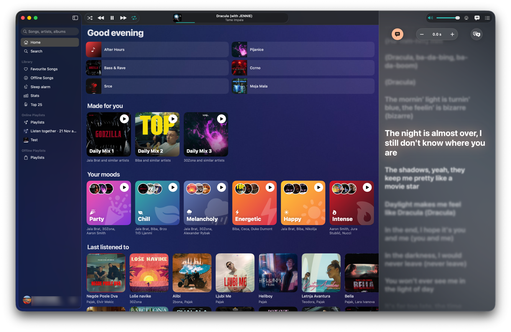
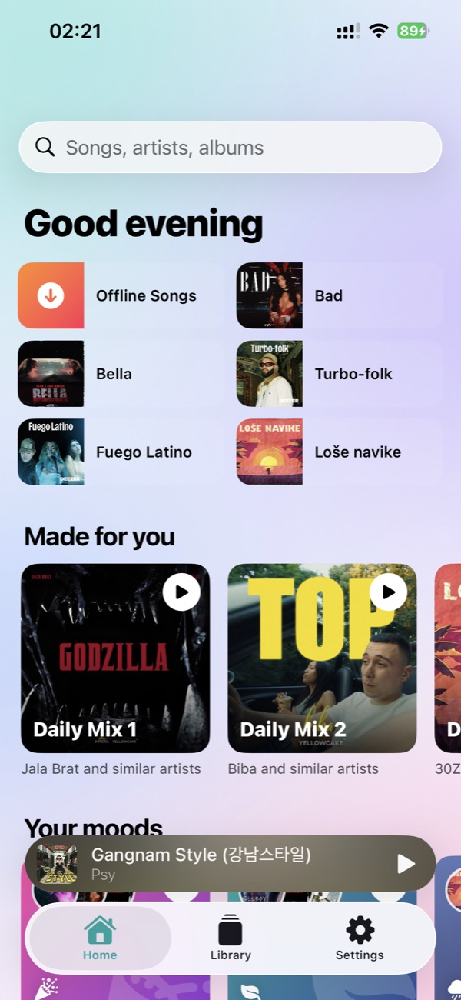
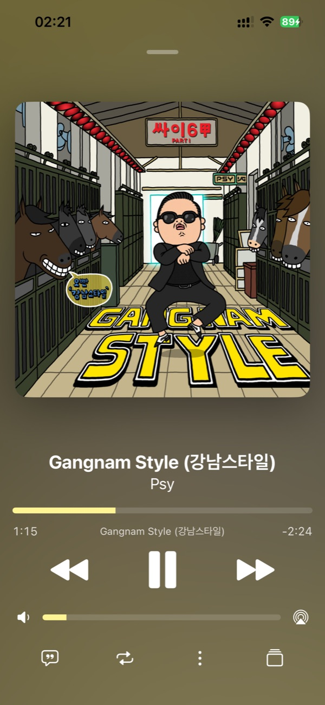
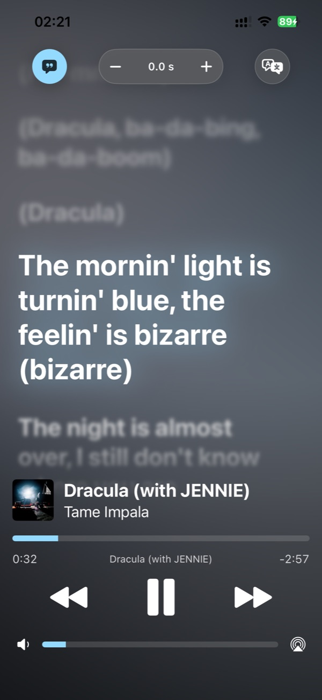
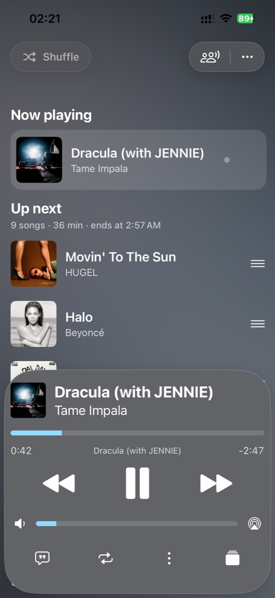
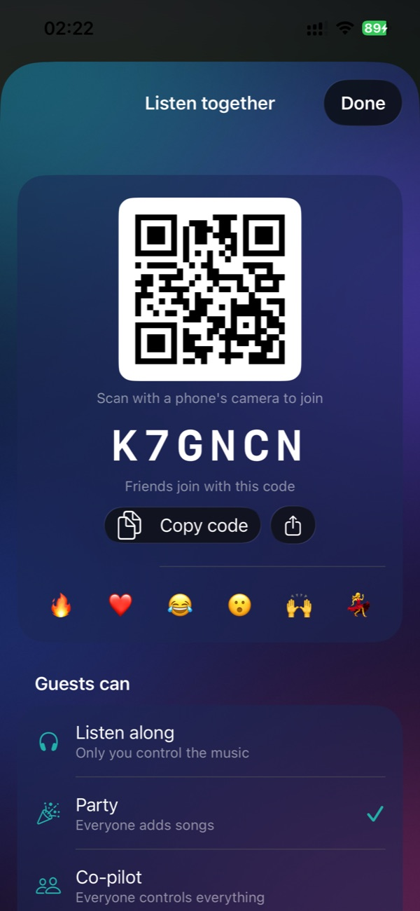
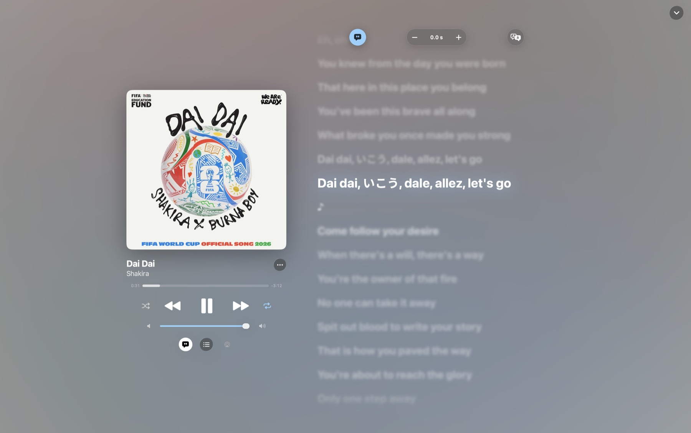
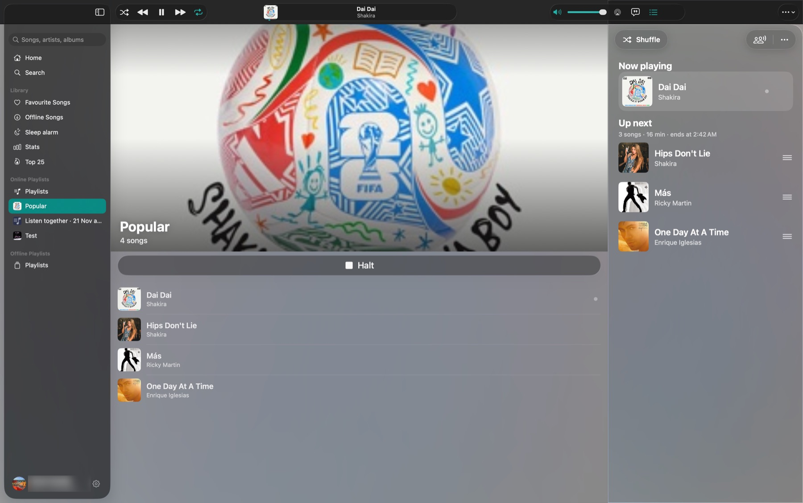

# Pongo


Pongo is a music streaming app you host yourself: native **iPhone and Mac** apps in SwiftUI and a FastAPI server that runs in Docker on any machine you have.

- **No Spotify and no paid APIs:** song, album and artist data comes from the public Deezer API, and the audio is matched on YouTube Music and downloaded with yt-dlp.
- **Your own server:** at home on your network, or reachable from anywhere over HTTPS.
- **No ads, no premium tier, no tracking.**
- **Open source** under the [MIT License](LICENSE).

**To set it up yourself, run `./setup.sh` and follow [SELF_HOSTING.md](SELF_HOSTING.md): about ten minutes, no keys or accounts needed.** It's meant for personal use, for you and maybe a few friends, not for running a public service; see the note at the top of the guide.

<p align="center">
  
</p>

<p align="center">
  
  &nbsp;
  
  &nbsp;
  
</p>

## Why it's back

Pongo stopped working when Spotify restricted its developer API in 2026. It's been rebuilt so that nothing depends on a service that can switch it off: the catalog comes from Deezer's open API, the audio is stored on your own server, and the apps were rewritten natively for iPhone and Mac (in [`apple/`](apple/)). The original Flutter app is archived: see [The Flutter app](#the-flutter-app) below.

## Features

### Listening


- **Live lyrics:** synchronized lyrics that follow the song, with manual timing, translations, and a Live Activity on the lock screen while listening together.
- **Mix mode and smart shuffle:** similar songs keep coming before the queue runs out.
- **Moods and daily mixes** made from what you listen to.
- **Even volume** so every song plays at about the same loudness, and an optional **bass boost**.
- **Sleep alarm:** fades the music out as you fall asleep and back in to wake you.
- **Queue management:** reorder, remove, play next, shuffle and repeat.
- **Offline songs and playlists** for listening without internet.

<br clear="right" />

### Listening together


Friends follow your queue live on their own phones or Macs, each on their own account and headphones.
- Presets (**Listen along**, **Party**, **Co-pilot**) or custom rights for adding songs, playback, managing the queue, modes and taking over, for everyone or per guest.
- **Vote to skip**, **emoji reactions**, and **song suggestions** the host adds or declines.
- Join by **QR code or link**, set a **headphone delay** for Bluetooth, and pass the session to someone else.
- A **recap** at the end, which saves what played as a playlist.

<br clear="right" />

### Your library
- Favourites, online and offline playlists, history, sleep alarms and settings **sync across your devices**.
- **Stats:** top songs and artists by month and year, minutes listened, and a **Top 25** playlist that keeps itself up to date.
- Hide songs in a playlist without removing them.

### On your devices
- **Widgets** on iPhone and Mac: Now Playing, and your Top Songs.
- **Siri and Shortcuts:** "Play my favourites in Pongo", "Play my top songs in Pongo".
- A **Mac app with its own layout**: sidebar, toolbar player, lyrics and queue panel, and menus.
- **Liquid Glass** design with colors taken from the album art.
- Sign in with Google. English, Deutsch and Hrvatski.

<p align="center">
  
  &nbsp;
  
</p>

## Built with


## Running it

On any machine with Docker:

```sh
git clone https://github.com/GoranSustekJr/pongo.git && cd pongo
./setup.sh
```

It generates the secrets, starts the server and prints its address. Install the app from the [latest release](https://github.com/GoranSustekJr/pongo/releases/latest) (`Pongo.ipa` through SideStore or AltStore, or `Pongo-Mac.zip`), type in the address and create an account. No Google or Apple keys are needed. To use it away from home, [Tailscale](SELF_HOSTING.md#4-optional-use-it-away-from-home) is one command; HTTPS on your own domain through Caddy and Let's Encrypt is covered too. [SELF_HOSTING.md](SELF_HOSTING.md) has the details: invite-only servers, Google sign-in and building the apps yourself.

Audio lives in the `pongo_audio` volume and the database in `pongo_db`. Back up both.

Tests: `swift test` in `apple/PongoKit/`, and `python -m pytest tests` in `api/pongo/`.

## How Does It Work?

### Catalog

Search, albums, artists, playlists, genres and new releases come from the public [Deezer API](https://developers.deezer.com/api), which needs no key. The server reshapes the responses into the JSON the app's models expect (`api/pongo/library/metadata/deezer.py`), so another provider can be swapped in there.

### Getting a track onto the server

1. The app opens a WebSocket to `/test` with the track id. The server answers `exists: true` if it already has the audio, otherwise `exists: false`.
2. For a new track, the server takes its title, artist and length from Deezer and searches YouTube Music, scoring results on title, artist and length and rejecting other recordings such as karaoke or live versions (`library/track/matcher.py`).
3. `yt-dlp` downloads the best match as m4a, first with its `visionos` YouTube client, which skips the roughly 5 second wait the default clients need, and with the default clients if that fails (`YTDLP_PLAYER_CLIENTS`). The file is hashed, and it is stored on the audio volume under its SHA-256 so identical audio is kept once.
4. The server sends the duration, or `exists: failed` if no good match exists. Concurrent requests for one track share a single download. For queues, playlists and mixes the server fetches up to `MAX_CONCURRENT_DOWNLOADS` (4) tracks ahead of the one being waited on.

### Playback

The native player requests `/play_song/{id}?st=<stream token>`, which serves the file with HTTP range support. The stream token is per device, expires after 7 days, and stops working when the device is removed or the user is disabled. Behind Caddy the API only checks the request and names the file, and Caddy sends it.

### Listening together

In the iOS and macOS apps, the queue's people button starts a session and shows a six-letter code that friends with an account on the same server join with. The host's app publishes its queue and playback position over the `/listen` WebSocket; guests' players follow it, correcting drift against the server's clock. What guests do to their player goes to the host as a request, which the server passes on only if the host allowed it: adding songs, playback, removing and reordering, shuffle and repeat, or playing something else, set by a preset (Listen along, Party, Co-pilot) or one by one, for everyone or per guest. Guests with the vote right skip a song once more than half of everyone listening voted, anyone can send emoji reactions that float up on everyone's player, and each guest can set a headphone delay so Bluetooth latency doesn't put them behind. Guests join by scanning the host's QR code or opening the shared link; guests who can't add songs suggest them instead, and the host adds or declines each. When a session ends, a recap lists what played and who added it, and saves it as a playlist. The host can pass the session to a guest, and it passes to the guest who joined first when the host leaves or stays disconnected for 30 seconds. Sessions live in the server's memory only.

### Mix Mode

When a single track is played with mix on, the app keeps the queue going: whenever two or fewer tracks are left, it posts the last five tracks played and everything already queued to `/next_mix_tracks`. The server picks similar tracks from the Deezer radios of those tracks' artists and the latest artist's related artists, downloads three of them, and returns them with their lengths; it keeps no mix state between calls. The app makes one such request at a time, drops answers for a queue it has since left, and after a failure tries again with growing delays.

## The Flutter app

The Flutter app came first. It's no longer developed: the code is kept in git under the tag [`archive/flutter`](../../tree/archive/flutter) (in `frontend/`), and its desktop work under `archive/flutter-macos`. It still runs against the same server, and a library syncs with the native apps. Demo videos: [March 2025](https://youtu.be/PcywrO85vYY) and [July 2025](https://youtu.be/VLkgnx1HZGk), with an updated UI.


